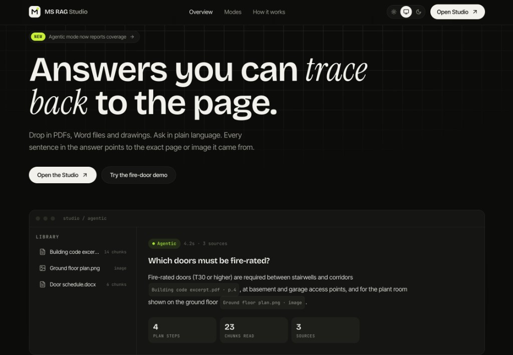
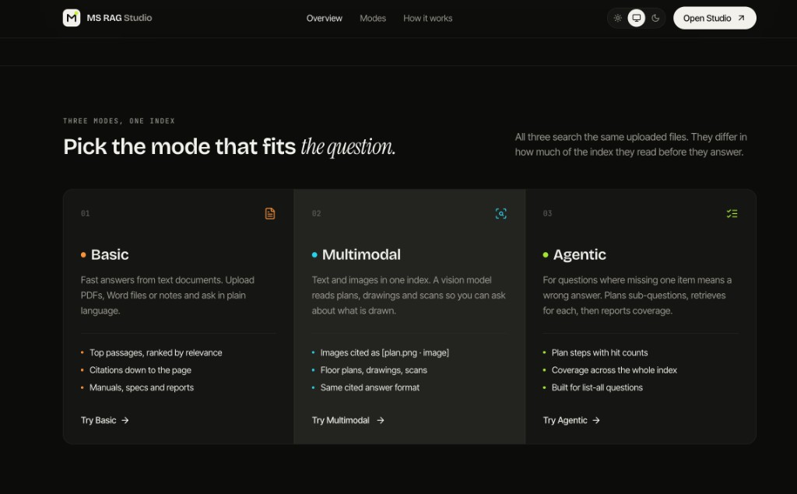
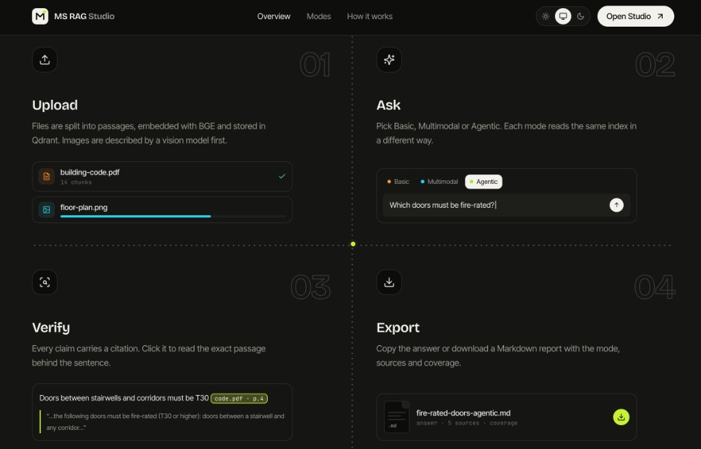
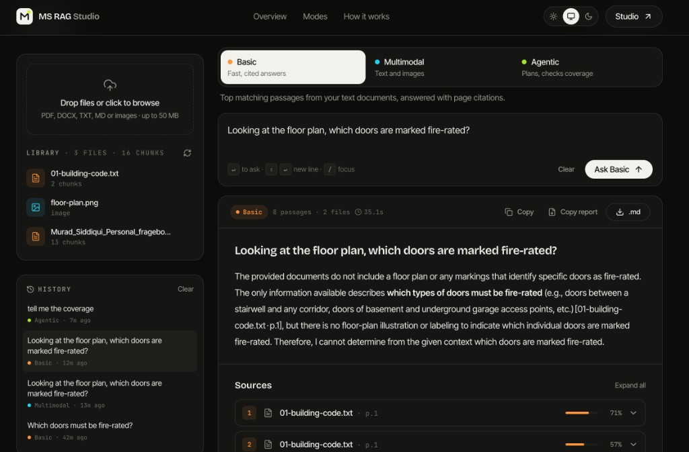

# MS RAG Studio

Cited question answering over your own documents and drawings.

Indexes PDFs, Word files, text, and images, then answers in **Basic**, **Multimodal**, **Agentic**, or **STAIR** mode with citations back to the supporting page, section, or image.

**Live demo:** [ms-rag-studio-muradsiddiqui.vercel.app](https://ms-rag-studio-muradsiddiqui.vercel.app)



---

## Modes

| Mode | Behaviour |
| --- | --- |
| **Basic** | Dense retrieval over text; page-level citations |
| **Multimodal** | Text + vision-described images; cites `[file · image]` |
| **Agentic** | Plans sub-questions, retrieves per step, returns coverage |
| **STAIR** | Structure-aware: reads the table of contents, opens the section that should hold the answer, reads it in full; citations name the section |

Also: ask-scope (limit a query to selected library files), history, Markdown export, light / dark / system theme.








---

## Architecture

```
Browser (Next.js on Vercel)
        │  HTTPS
        ▼
FastAPI (Railway)  ──►  BGE embeddings (local)
        │               Groq (answers / planning)
        │               Gemini (image descriptions)
        ▼
   Qdrant Cloud
```

n8n under `n8n/` is optional batch/scheduling only — not required for the Studio path.

| Layer | Runtime | Notes |
| --- | --- | --- |
| UI | Vercel · `frontend/` | `NEXT_PUBLIC_API_URL` → API origin |
| API | Railway · `backend/` | Persistent Python; ≥2 GB RAM |
| Vectors | Qdrant Cloud | Collection `msrag_chunks` |
| LLMs | Groq + Gemini | Via `MSRAG_*` env vars |

---

## Repository layout

```
frontend/          Next.js app
backend/           FastAPI (upload, ingest, ask, report)
data/demo/         Sample documents
docs/images/       Screenshots
n8n/workflows/     Optional automation
Dockerfile         Production image (repo root → backend)
```

---

## Local development

Python 3.11+, Node 18+, keys for Groq, Qdrant, and Gemini (images).

```bash
cd backend
python -m venv .venv && source .venv/bin/activate
pip install -r requirements.txt
cp .env.example .env   # fill MSRAG_*
uvicorn app.main:app --reload --port 8000
```

```bash
cd frontend
npm install && npm run dev
```

Open [http://localhost:3000](http://localhost:3000). Wait until `GET /health` shows `model_ready: true` before uploading.

```bash
docker compose up -d   # optional local Qdrant / n8n
```

---

## Production

### API (Railway)

1. Deploy this repo (root `Dockerfile`).
2. Set vars from `backend/.env.example`.
3. Generate a public HTTPS domain.
4. Use a Qdrant key that allows Railway egress (not IP-locked to a home network).

### UI (Vercel)

| Setting | Value |
| --- | --- |
| Root Directory | `frontend` |
| `NEXT_PUBLIC_API_URL` | `https://<api-host>` |
| `NEXT_PUBLIC_SITE_URL` | optional canonical site URL |

Redeploy after env changes. CORS allows `*.vercel.app` and localhost; extend in `backend/app/main.py` for custom domains.

---

## Configuration

See `backend/.env.example` and `frontend/.env.example`. Do not commit secrets.

| Variable | Purpose |
| --- | --- |
| `MSRAG_GROQ_API_KEY` | Chat + planning |
| `MSRAG_QDRANT_URL` / `MSRAG_QDRANT_API_KEY` | Vector store |
| `MSRAG_EMBED_MODEL` | Default `BAAI/bge-small-en-v1.5` |
| `MSRAG_GEMINI_API_KEY` | Image descriptions |
| `MSRAG_VISION_PROVIDER` | `auto` \| `gemini` \| `groq` |
| `NEXT_PUBLIC_API_URL` | Browser → API base URL |

---

## License

Private project · © Murad Siddiqui
