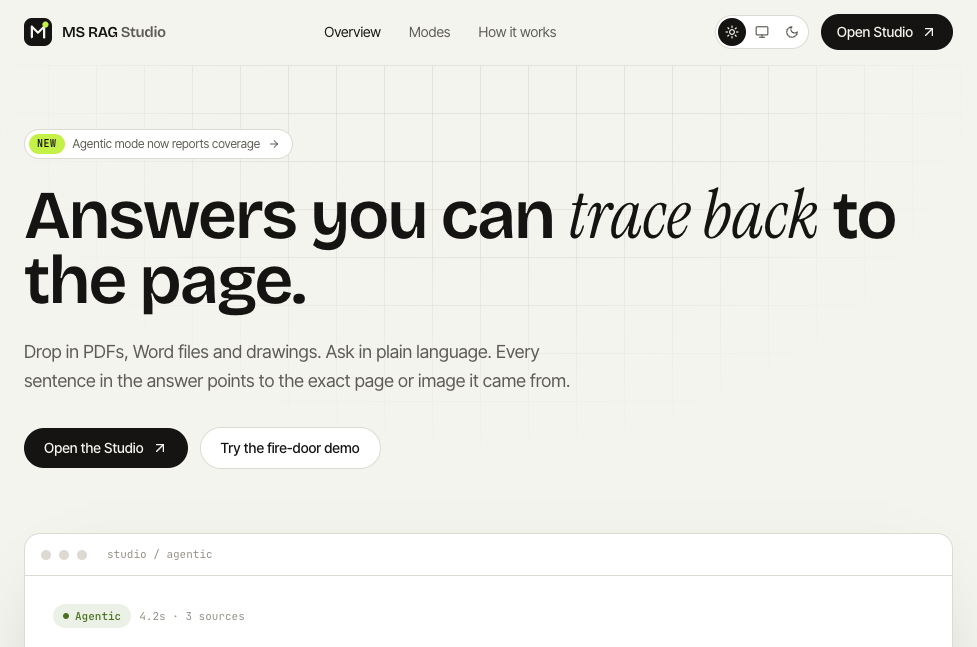
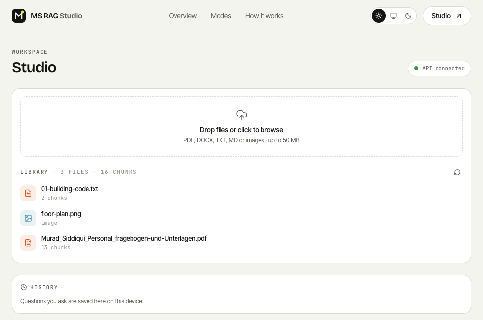
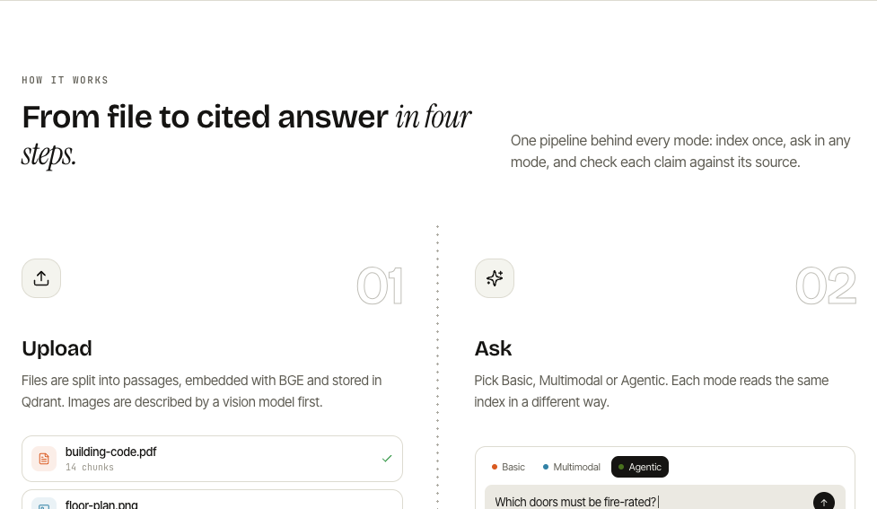

# MS RAG Studio

Cited question answering over your own documents and drawings.

MS RAG Studio indexes PDFs, Word files, plain text, and images, then answers in three retrieval modes — **Basic**, **Multimodal**, and **Agentic** — with inline citations back to the page or image that supports each claim.

**Live demo:** [ms-rag-studio-muradsiddiqui.vercel.app](https://ms-rag-studio-muradsiddiqui.vercel.app)



---

## Features

| Mode | Behaviour |
| --- | --- |
| **Basic** | Dense retrieval over text chunks; answers with page citations |
| **Multimodal** | Same index including vision-described images; cites `[file · image]` |
| **Agentic** | Plans sub-questions, retrieves per step, returns a coverage report |

Also included: document library with ask-scope (limit a query to selected files), session history, Markdown report export, and light / dark / system theme.





---

## Architecture

```
Browser (Next.js on Vercel)
        │  HTTPS
        ▼
FastAPI (Railway)  ──►  BGE embeddings (local)
        │               Groq (answers / planning)
        │               Gemini (image descriptions)
        ▼
   Qdrant Cloud
```

n8n workflows under `n8n/` are optional for batch ingestion and scheduled jobs. They are not required for the interactive Studio path.

| Layer | Runtime | Notes |
| --- | --- | --- |
| UI | Vercel · `frontend/` | Set `NEXT_PUBLIC_API_URL` to the API origin |
| API | Railway (or similar) · `backend/` | Long-running Python process; ≥2 GB RAM recommended |
| Vectors | Qdrant Cloud | Collection `msrag_chunks` |
| LLMs | Groq + Gemini | Keys via `MSRAG_*` env vars |

The embedding model cannot run on Vercel serverless; keep the API on a host that supports Docker / persistent Python.

---

## Repository layout

```
frontend/          Next.js 14 app (Studio + marketing pages)
backend/           FastAPI: upload, ingest, ask, report
data/demo/         Sample documents for local checks
docs/images/       README screenshots
n8n/workflows/     Optional automation
Dockerfile         Production image (repo root → backend)
```

---

## Local development

**Prerequisites:** Python 3.11+, Node 18+, API keys for Groq, Qdrant, and (for images) Gemini.

```bash
# API
cd backend
python -m venv .venv && source .venv/bin/activate
pip install -r requirements.txt
cp .env.example .env   # fill MSRAG_* values
uvicorn app.main:app --reload --port 8000
```

```bash
# UI — proxies /backend/* to localhost:8000 when NEXT_PUBLIC_API_URL is unset
cd frontend
npm install
npm run dev
```

Open [http://localhost:3000](http://localhost:3000). Confirm `GET /health` returns `model_ready: true` before the first upload (first boot downloads BGE).

Optional local Qdrant / n8n:

```bash
docker compose up -d
```

---

## Production

### API (Railway)

1. Connect this GitHub repo; build uses the root `Dockerfile`.
2. Set variables from `backend/.env.example` (`MSRAG_GROQ_API_KEY`, `MSRAG_QDRANT_URL`, `MSRAG_QDRANT_API_KEY`, `MSRAG_EMBED_MODEL`, `MSRAG_GEMINI_API_KEY`, `MSRAG_VISION_PROVIDER`).
3. Publish a public HTTPS domain.
4. Ensure the Qdrant API key allows Railway’s egress (no home-IP-only restriction).

Health check: `https://<api-host>/health`

### UI (Vercel)

| Setting | Value |
| --- | --- |
| Root Directory | `frontend` |
| Framework | Next.js |
| Env | `NEXT_PUBLIC_API_URL=https://<api-host>` |
| Env (optional) | `NEXT_PUBLIC_SITE_URL=https://<your-vercel-domain>` |

Redeploy after changing env vars so `NEXT_PUBLIC_*` values are baked into the client bundle.

CORS on the API already allows `*.vercel.app` and localhost. Add custom domains in `backend/app/main.py` if needed.

---

## Configuration reference

See `backend/.env.example` and `frontend/.env.example`. Never commit real `.env` files.

| Variable | Purpose |
| --- | --- |
| `MSRAG_GROQ_API_KEY` | Chat + planning |
| `MSRAG_QDRANT_URL` / `MSRAG_QDRANT_API_KEY` | Vector store |
| `MSRAG_EMBED_MODEL` | Default `BAAI/bge-small-en-v1.5` |
| `MSRAG_GEMINI_API_KEY` | Image descriptions |
| `MSRAG_VISION_PROVIDER` | `auto` \| `gemini` \| `groq` |
| `NEXT_PUBLIC_API_URL` | Browser → API base URL |

---

## License

Private project · © Murad Siddiqui
