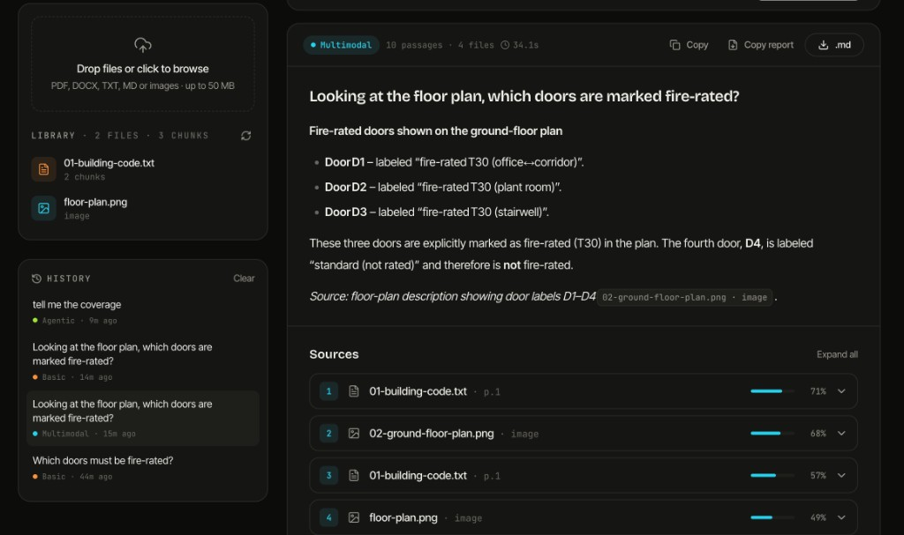

# MS RAG Studio

Cited question answering over your own documents and drawings.

Indexes PDFs, Word files, text, and images, then answers in **Basic**, **Multimodal**, **Agentic**, or **STAIR** mode with citations back to the supporting page, section, or image.

**Live demo:** [ms-rag-studio-muradsiddiqui.vercel.app](https://ms-rag-studio-muradsiddiqui.vercel.app)


---

## Modes

| Mode | Behaviour |
| --- | --- |
| **Basic** | Dense retrieval over text; page-level citations |
| **Multimodal** | Text + vision-described images; cites `[file · image]` |
| **Agentic** | Plans sub-questions, retrieves per step, returns coverage |
| **STAIR** | Structure-aware: reads the table of contents, opens the section that should hold the answer, reads it in full; citations name the section |

STAIR mode is inspired by IBM Research's [STAIR](https://arxiv.org/abs/2609.03874), a retriever that navigates a document's table of contents. It is a retrieval step inside RAG, not a replacement for it. IBM fine-tunes a model for the navigation; here an off-the-shelf LLM picks sections from the table of contents in the prompt, and the mode falls back to vector search when no section fits.

Also: ask-scope (limit a query to selected library files), file preview, history, Markdown export, light / dark / system theme.

Each browser gets its own private library: a random workspace id stored in the browser is sent with every request, and the API only returns that workspace's files. There are no accounts, so clearing site data starts an empty library. API calls without the `X-Workspace-Id` header (n8n, curl) use a shared `default` workspace.




---

## Architecture

```
Browser (Next.js on Vercel)
        │  HTTPS
        ▼
FastAPI (Railway)  ──►  BGE embeddings (local)
        │               Groq (answers / planning)
        │               Gemini (image descriptions)
        ▼
   Qdrant Cloud
```

n8n under `n8n/` is optional batch/scheduling only — not required for the Studio path.

| Layer | Runtime | Notes |
| --- | --- | --- |
| UI | Vercel · `frontend/` | `NEXT_PUBLIC_API_URL` → API origin |
| API | Railway · `backend/` | Persistent Python; ≥2 GB RAM |
| Vectors | Qdrant Cloud | Collection `msrag_chunks` |
| LLMs | Groq + Gemini | Via `MSRAG_*` env vars |

---

## Repository layout

```
frontend/          Next.js app
backend/           FastAPI (upload, ingest, ask, report)
data/demo/         Sample documents
docs/images/       Screenshots
n8n/workflows/     Optional automation
Dockerfile         Production image (repo root → backend)
```

---

## Local development

Python 3.11+, Node 18+, keys for Groq, Qdrant, and Gemini (images).

```bash
cd backend
python -m venv .venv && source .venv/bin/activate
pip install -r requirements.txt
cp .env.example .env   # fill MSRAG_*
uvicorn app.main:app --reload --port 8000
```

```bash
cd frontend
npm install && npm run dev
```

Open [http://localhost:3000](http://localhost:3000). Wait until `GET /health` shows `model_ready: true` before uploading.

```bash
docker compose up -d   # optional local Qdrant / n8n
```

---

## Production

### API (Railway)

1. Deploy this repo (root `Dockerfile`).
2. Set vars from `backend/.env.example`.
3. Generate a public HTTPS domain.
4. Use a Qdrant key that allows Railway egress (not IP-locked to a home network).

### UI (Vercel)

| Setting | Value |
| --- | --- |
| Root Directory | `frontend` |
| `NEXT_PUBLIC_API_URL` | `https://<api-host>` |
| `NEXT_PUBLIC_SITE_URL` | optional canonical site URL |

Redeploy after env changes. CORS allows `*.vercel.app` and localhost; extend in `backend/app/main.py` for custom domains.

---

## Configuration

See `backend/.env.example` and `frontend/.env.example`. Do not commit secrets.

| Variable | Purpose |
| --- | --- |
| `MSRAG_GROQ_API_KEY` | Chat + planning |
| `MSRAG_QDRANT_URL` / `MSRAG_QDRANT_API_KEY` | Vector store |
| `MSRAG_EMBED_MODEL` | Default `BAAI/bge-small-en-v1.5` |
| `MSRAG_GEMINI_API_KEY` | Image descriptions |
| `MSRAG_VISION_PROVIDER` | `auto` \| `gemini` \| `groq` |
| `NEXT_PUBLIC_API_URL` | Browser → API base URL |

---

## License

Private project · © Murad Siddiqui

## Case Study: Building-Code Research

A focused case study built for a conversation with HENN's Emergent Technologies team, exploring the two problems they described: **completeness instead of top-k** (for "list all" questions, a top-5 answer is dangerous) and **rules that live in structured lists and drawings**, not only in prose.

The Studio workspace `henn-case-study` is preloaded with an excerpt of the official Musterbauordnung (MBO) — § 2 (Gebäudeklassen) and §§ 26–39 (Brandschutz, Rettungswege) — plus a ground-floor plan whose 9 doors (D1–D9) are numbered but deliberately carry no fire ratings, so every rating in an answer must come from the code:


Demo questions: which doors in this plan must be fire-resistant or smoke-tight (Multimodal), the same as a list-all question with the coverage report (Agentic), table-of-contents navigation (STAIR), a Gebäudeklasse classification (§ 2 Abs. 3), and an out-of-corpus question the system must decline (Großgaragen).

Corpus notes, measured verification results and the demo runbook live in [`case-study/`](case-study/CASE-STUDY.md) and [`case-study/RUNBOOK.md`](case-study/RUNBOOK.md). Prototype, not production software.

### Try it yourself

All demo files are in the [`case-study/`](case-study/) folder:

- [Building-code excerpt, MBO § 2 and §§ 26-39 (PDF)](https://github.com/MuradSiddiqui/MSRAGStudio/blob/main/case-study/MBO-Auszug-Gebaeudeklassen-Brandschutz.pdf)
- [Ground-floor plan with doors D1-D9 (PNG)](https://github.com/MuradSiddiqui/MSRAGStudio/blob/main/case-study/Grundriss-Erdgeschoss.png)
- [Door rules as cleaned text, §§ 35, 36 and 39](https://github.com/MuradSiddiqui/MSRAGStudio/blob/main/case-study/Tueren-Schluesselregeln-MBO.txt)
- [§ 2 building classes as text](https://github.com/MuradSiddiqui/MSRAGStudio/blob/main/case-study/Gebaeudeklassen-MBO-Par2.txt)
- [Full case-study write-up](https://github.com/MuradSiddiqui/MSRAGStudio/blob/main/case-study/CASE-STUDY.md)

1. Open the live Studio: https://ms-rag-studio-muradsiddiqui.vercel.app/studio
2. Upload the excerpt PDF and the plan PNG.
3. Select **Multimodal** and ask: "Welche Türen in diesem Grundriss müssen feuerhemmend oder rauchdicht sein?"

Or upload your own guideline document and your own plan export, and ask your own question. Every answer is grounded in your documents and cited to page, section or image.
